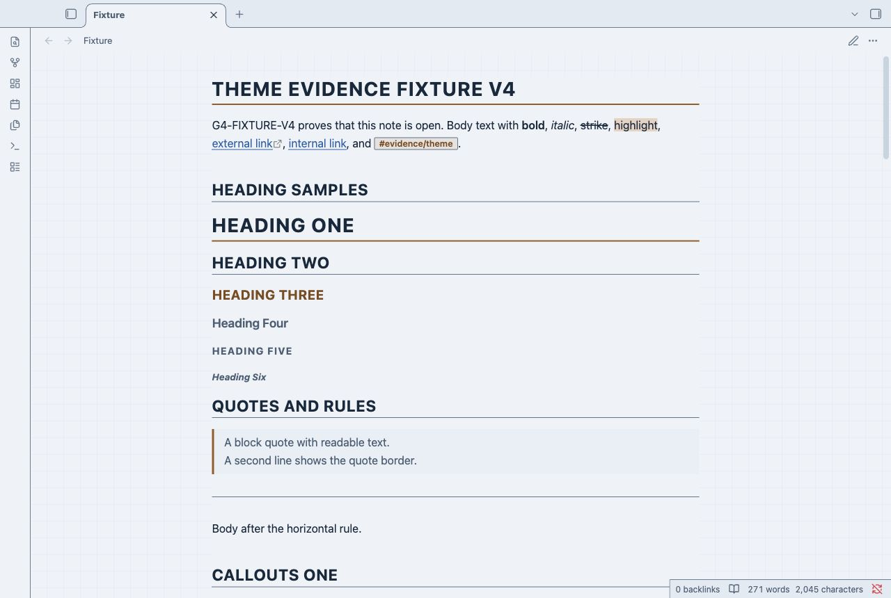
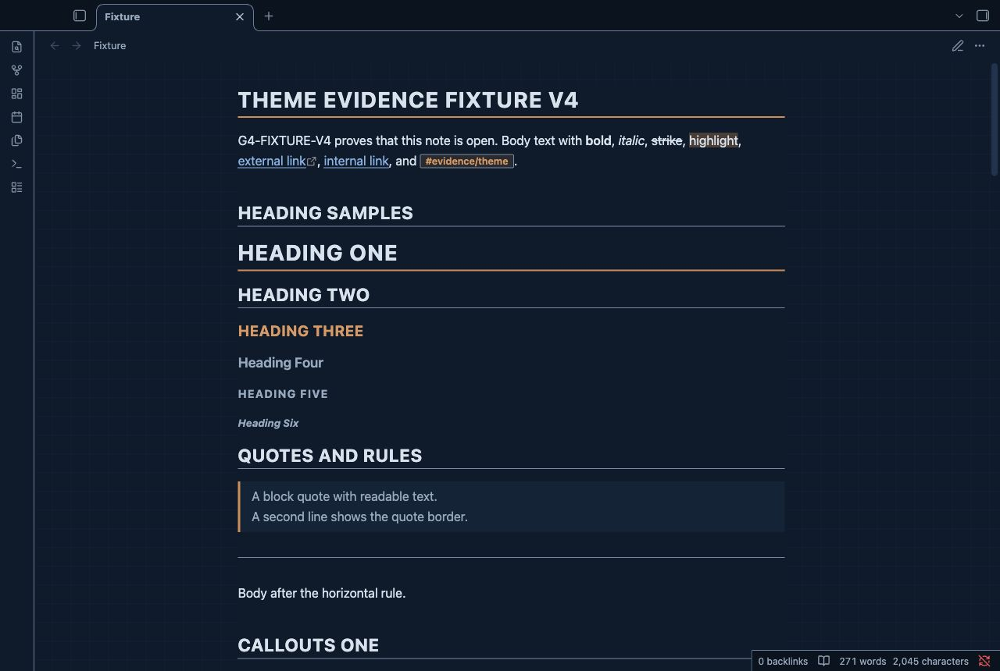
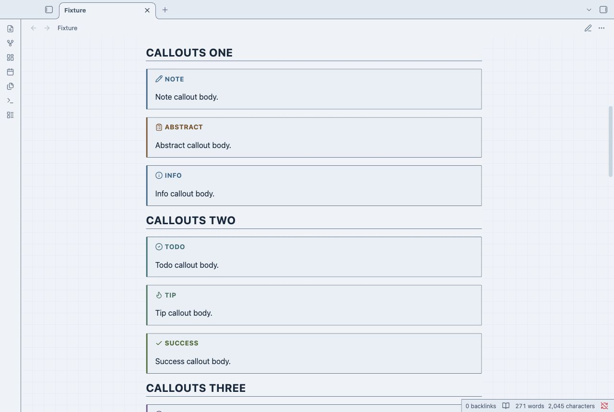
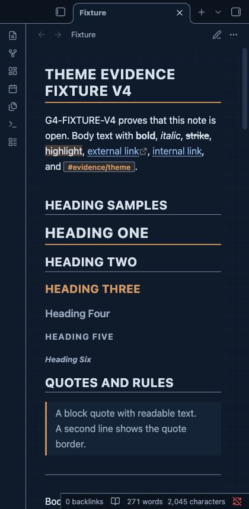

# Engineering Notebook

Engineering Notebook gives specifications, measurements, and design records a blueprint page.
Copper rules mark the headings. Square controls and full table grids keep the layout precise.
The graph lines stay in the margins outside a solid note sheet.
They are decoration. They do not carry information.
The editor uses a visible caret. It has no frame around the writing surface.

## Screenshots

The captures show the installed theme in the Obsidian desktop renderer.
A narrow desktop capture is not a mobile device test.






## Install

1. Download `theme.css` and `manifest.json` from this repository.
2. Open your vault folder.
3. Create `.obsidian/themes/Engineering Notebook/` in that folder.
4. Copy both files into `Engineering Notebook`.
5. Open Settings in Obsidian.
6. Open Appearance.
7. Select **Engineering Notebook** in the theme list.

Keep the installed folder name equal to the manifest name.
The repository folder name is a GitHub slug. Do not use it as the installed folder name.

## Uninstall

1. Open Settings.
2. Open Appearance.
3. Select the default theme.
4. Remove `.obsidian/themes/Engineering Notebook/` from your vault.

Your note files remain in the vault.

## Content styles

Headings H1 and H2 have ruled titles. H3 uses copper text.
H4 uses a larger mixed-case label. H5 uses small uppercase text.
H6 uses smaller italic text.
Callouts use a stamped title, a type icon, and a color-coded edge.
Nested lists use compact guide rules. Completed tasks use a checkmark and muted text.
An unfinished nested task keeps its normal text color.
Tables use full borders and tabular numbers.
Code uses a plain panel. Inline code uses a small outlined label.
Quotes and note embeds use a copper edge.
Tags use square labels. Links have underlines.
Unresolved links have dashed underlines.
Horizontal rules divide note sections.

## Compatibility

The manifest keeps Obsidian 1.1.0 as the minimum version.
The G4 evidence uses the Obsidian 1.14.4 desktop renderer.
Reading view and Live Preview are tested in light and dark modes.
Mobile is not tested.
Community plugin layouts are not tested.

## Customization

Add a CSS snippet in your vault to change these variables:

```css
body {
  --eng-grid-size: 32px;
  --eng-radius: 4px;
  --line-height-normal: 1.7;
}
.theme-light { --eng-grid: transparent; }
.theme-dark { --eng-grid: transparent; }
```

Use the Obsidian Accent color setting for selected settings rows, checked controls, and sliders.
Set `--eng-accent` and `--eng-accent-strong` in each mode to change document rules and focus rings.
Set `--eng-rule` and `--eng-rule-strong` to change structural borders.
Check contrast after you change a color.
Style Settings is not required. This theme has no Style Settings panel.
Fonts use the local system font stack. The theme does not load network assets.

## Known limits

- Uppercase H1 to H3 titles suit short specification headings. Long titles can wrap.
- The graph stays outside the body text. Disable it with `--eng-grid: transparent` for a plain page.
- Wide tables and long code lines use horizontal scrolling in narrow panes.
- Callout colors identify specification types. The icon and label also identify the type.
- Automated contrast and keyboard checks do not prove screen-reader compatibility.

## License

[MIT License](LICENSE). Original copyright: U3 Theme Factory, 2026.
NoteMods maintains this theme.
